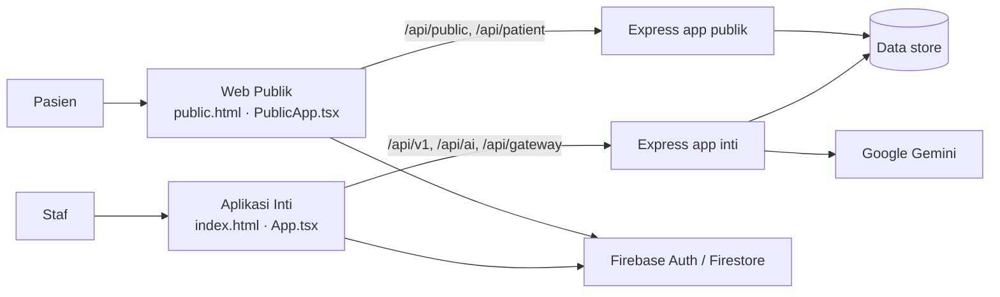

# MYITARU

[](https://github.com/dimzzthareza231-design/MYAPP/actions/workflows/ci.yml)

Sistem informasi manajemen klinik (SIMK) dan rekam medis elektronik (RME) berbasis web, dilengkapi fitur kecerdasan buatan untuk mendukung pelayanan dan manajemen operasional. MYITARU terdiri atas dua aplikasi yang dibangun dari satu kode sumber:

| Aplikasi | Untuk | Alamat |
|---|---|---|
| **Web Publik MYITARU** | Pasien dan masyarakat: portal klinik, jadwal dokter, pendaftaran daring, cek antrean, aplikasi pasien (PWA) | https://web-publik-myitaru.vercel.app |
| **Aplikasi Inti MYITARU** | Staf: login pegawai, dasbor, 55 modul SIMK/RME, portal karyawan | https://aplikasi-inti-myitaru.vercel.app |

> Data pada aplikasi ini adalah data demo. Jangan memasukkan data pasien sebenarnya sebelum butir pada [Keamanan dan keterbatasan](#keamanan-dan-keterbatasan) diselesaikan.

## Daftar isi

- [Fitur](#fitur)
- [Arsitektur](#arsitektur)
- [Teknologi](#teknologi)
- [Struktur proyek](#struktur-proyek)
- [Menjalankan secara lokal](#menjalankan-secara-lokal)
- [Variabel lingkungan](#variabel-lingkungan)
- [Skrip npm](#skrip-npm)
- [Pengujian](#pengujian)
- [Deployment](#deployment)
- [Keamanan dan keterbatasan](#keamanan-dan-keterbatasan)

## Fitur

**Web publik pasien**
- Portal klinik dengan jadwal dokter, layanan unggulan, dan informasi rawat inap.
- Pendaftaran kunjungan daring yang langsung menerbitkan nomor rekam medis dan nomor antrean.
- Aplikasi pasien (`/mobile`) dengan verifikasi No. RM + tanggal lahir atau **akun Google**, berisi antrean aktif, tanda vital, hasil lab/radiologi, tagihan, dan kartu berobat QR.

**Aplikasi inti**
- Modul pelayanan: pendaftaran, IGD, triase, rawat jalan, rawat inap, kamar operasi, ICU, rehabilitasi medik, gizi, telemedisin.
- Rekam medis elektronik: resume medis, kodefikasi ICD-10/ICD-9-CM, audit kelengkapan (KLPCM), peminjaman dan retensi berkas.
- Penunjang dan keuangan: laboratorium, radiologi/PACS, farmasi, kasir, klaim BPJS.
- Integrasi (mode simulasi): BPJS VClaim, SATUSEHAT, Orthanc, WA Gateway, dan lainnya.
- Manajemen: laporan, audit trail, pencadangan, pemantauan sistem, kendali akses berbasis peran (17 peran).
- Portal karyawan dengan verifikasi dua langkah (MFA) untuk peran sensitif.

**Kecerdasan buatan** (`/api/ai/*`, hanya di aplikasi inti)

| Fitur | Endpoint |
|---|---|
| Analisis catatan klinis dan saran kode ICD-10 | `POST /api/ai/analyze` |
| Dukungan keputusan klinis (CDSS) | `POST /api/ai/clinical-decision-support` |
| Pemeriksaan interaksi obat | `POST /api/ai/drug-interaction` |
| Audit kelengkapan dokumen rekam medis | `POST /api/ai/document-completeness` |
| Audit kelayakan klaim BPJS | `POST /api/ai/bpjs-audit` |
| Ringkasan pulang | `POST /api/ai/clinical-summary` |
| Asisten klinis | `POST /api/ai/copilot` |

Fitur AI berjalan bertingkat: model Google Gemini sebagai mesin utama, lalu mesin aturan deterministik sebagai cadangan bila kunci API tidak tersedia atau pemanggilan model gagal. Keluaran AI bersifat pendukung keputusan dan tetap harus diverifikasi tenaga kesehatan.

## Arsitektur



- `server.ts` mengekspor `createApps()` yang membangun dua aplikasi Express. Web publik hanya membuka `/api/public/*` dan `/api/patient/*`; aplikasi inti membuka `/api/v1/*`, `/api/ai/*`, `/api/gateway/*`, dan `/api/cloudflare/*`. Permintaan ke API inti dari domain publik selalu dijawab 404.
- **Lokal/Docker:** kedua aplikasi berjalan dalam satu proses pada port `3000` (publik) dan `3001` (inti).
- **Vercel:** dua proyek terpisah. `api/index.ts` adalah satu Vercel Function yang memilih aplikasi lewat variabel `APP_TARGET`.
- Sesi pasien, sesi karyawan, dan tantangan MFA memakai token bertanda tangan HMAC-SHA256 (`src/server/signedStore.ts`) sehingga tetap valid di lingkungan serverless multi-instans.

## Teknologi

| Lapisan | Teknologi |
|---|---|
| Antarmuka | React 19, React Router 7, Vite 6, Tailwind CSS 4, Motion, Recharts, Leaflet |
| Server | Node.js ≥ 20, Express 4, TypeScript 5.8 |
| AI | Google Gemini melalui `@google/genai` |
| Data & autentikasi | Firebase Authentication, Cloud Firestore |
| PWA | `vite-plugin-pwa` (Workbox) |
| Deployment | Vercel (dua proyek), Docker multi-stage |
| Pengujian & CI | `node:test` + `tsx`, GitHub Actions |

## Struktur proyek

```
├── api/                    Vercel Function untuk seluruh /api/*
├── database/schemas/       Skema SQL untuk migrasi ke basis data relasional
├── public/                 Aset statis (ikon, service worker FCM)
├── scripts/                Pemeriksaan pra-deployment
├── src/
│   ├── App.tsx             Rute aplikasi inti
│   ├── PublicApp.tsx       Rute web publik
│   ├── components/         Modul antarmuka (RME, BPJS, Farmasi, Portal, dll.)
│   ├── contexts/           State global (auth, rumah sakit, antrean, audit)
│   ├── data/               Data demo dan registri modul
│   ├── lib/                Firebase, FCM, logger aktivitas
│   └── server/             Layanan API pasien, gateway karyawan, mesin AI, token sesi
├── tests/                  Pengujian API black-box
├── server.ts               Server Express (dua aplikasi)
├── index.html              Halaman aplikasi inti
├── public.html             Halaman web publik
├── vite.config.ts          Build aplikasi inti
└── vite.public.config.ts   Build web publik
```

## Menjalankan secara lokal

Prasyarat: Node.js 20 atau lebih baru (lihat `.nvmrc`).

```bash
npm ci
cp .env.example .env    # isi nilai yang diperlukan
npm run dev
```

- Web publik: http://localhost:3000
- Aplikasi inti: http://localhost:3001 (halaman login staf menyediakan akun demo)

## Variabel lingkungan

| Variabel | Wajib | Keterangan |
|---|---|---|
| `SESSION_SECRET` | Produksi | Kunci tanda tangan token sesi. Isi dengan string acak panjang; tanpa ini token hanya berlaku selama satu proses. |
| `GEMINI_API_KEY` | Tidak | Kunci Google Gemini. Tanpa kunci, fitur AI memakai mesin aturan. |
| `APP_TARGET` | Vercel | `public` untuk proyek web publik, `core` untuk proyek aplikasi inti. |
| `PUBLIC_PORT` / `CORE_PORT` | Tidak | Port lokal/Docker, bawaan `3000` dan `3001`. |
| `VITE_FIREBASE_*` | Tidak | Konfigurasi Firebase; bila kosong memakai `firebase-applet-config.json`. |

## Skrip npm

| Skrip | Fungsi |
|---|---|
| `npm run dev` | Server pengembangan kedua aplikasi dengan Vite HMR |
| `npm test` | Pengujian API black-box (`tests/`) |
| `npm run typecheck` | Pemeriksaan tipe TypeScript |
| `npm run build` | Build lengkap: aplikasi inti, web publik, dan bundel server |
| `npm run build:core` / `build:public` | Build salah satu aplikasi |
| `npm start` | Menjalankan hasil build (`dist/server.cjs`) |

## Pengujian

```bash
npm test
```

Pengujian menjalankan kedua aplikasi Express di dalam proses dan memeriksa:
- isolasi API antara web publik dan aplikasi inti,
- pendaftaran daring, token sesi sah dan palsu,
- keluaran fitur AI pada mesin aturan (ICD-10, interaksi obat, audit klaim, audit dokumen),
- login portal karyawan dengan MFA.

GitHub Actions menjalankan typecheck, pengujian, dan kedua build pada setiap push ke `main` dan setiap pull request.

## Deployment

### Vercel

Buat dua proyek yang terhubung ke repositori ini:

| Pengaturan | Web Publik MYITARU | Aplikasi Inti MYITARU |
|---|---|---|
| Build Command | `npm run vercel-build:public` | `npm run vercel-build:core` |
| Output Directory | `dist/public` | `dist/core` |
| `APP_TARGET` | `public` | `core` |
| `SESSION_SECRET` | string acak | string acak |

Framework preset: *Other*. Perintah instalasi dan rewrite sudah diatur di `vercel.json`.

### Docker

```bash
docker build -t myitaru .
docker run -p 3000:3000 -p 3001:3001 -e SESSION_SECRET=... myitaru
```

Jangan membuka port `3001` (aplikasi inti) ke internet tanpa proteksi tambahan.

## Keamanan dan keterbatasan

- **API aplikasi inti belum diautentikasi di sisi server.** Pemisahan domain mencegah akses dari web publik, tetapi `/api/v1/*` masih dapat dipanggil langsung melalui alamat aplikasi inti. Langkah berikutnya: verifikasi token Firebase pada setiap permintaan.
- **Data disimpan di memori.** Data kembali ke kondisi awal saat instans dimulai ulang dan, di Vercel, tidak dibagi antara web publik dan aplikasi inti. Skema SQL di `database/schemas/` disiapkan untuk migrasi ke basis data persisten.
- Integrasi BPJS, SATUSEHAT, dan QRIS masih berupa simulasi.
- Keluaran AI belum dievaluasi akurasinya terhadap standar klinis dan wajib diverifikasi tenaga kesehatan.
- Login staf dengan nama pengguna dan kata sandi masih diverifikasi di sisi klien terhadap data demo.

Laporkan celah keamanan secara pribadi kepada pemilik repositori, bukan melalui issue publik.
