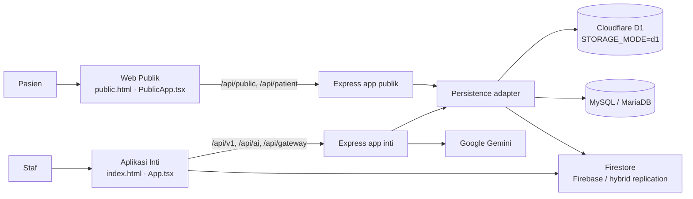

# MYITARU

[](https://github.com/dimzzthareza231-design/MYAPP/actions/workflows/ci.yml)


[](LICENSE)

Sistem informasi manajemen dan rekam medis elektronik (RME) berbasis web, dilengkapi fitur kecerdasan buatan untuk mendukung pelayanan dan manajemen operasional. MYITARU terdiri atas dua aplikasi yang dibangun dari satu kode sumber dan kini berjalan di **Cloudflare Workers** dengan database **Cloudflare D1**:

| Aplikasi | Untuk | Alamat |
|---|---|---|
| **Web Publik MYITARU** | Pasien dan masyarakat: portal layanan, jadwal dokter, pendaftaran daring, cek antrean, aplikasi pasien (PWA) | https://myitaru-public.myappv1.workers.dev |
| **Aplikasi Inti MYITARU** | Staf: login pegawai, dasbor, 55 modul SIMK/RME, portal karyawan | https://myitaru-core.myappv1.workers.dev |

Kode yang sama tetap dapat dijalankan secara lokal, dengan Docker, atau di Vercel (lihat [Deployment](#deployment)).

> Jangan memasukkan data pasien sebenarnya. Pendaftaran pasien dan kunjungan telah terhubung ke adapter persistence, tetapi migrasi modul klinis lain, backup/pemulihan, dan integrasi pembayaran belum selesai sehingga aplikasi belum siap produksi.

## Daftar isi

- [Fitur](#fitur)
- [Arsitektur](#arsitektur)
- [Teknologi](#teknologi)
- [Struktur proyek](#struktur-proyek)
- [Menjalankan secara lokal](#menjalankan-secara-lokal)
- [Variabel lingkungan](#variabel-lingkungan)
- [Skrip npm](#skrip-npm)
- [Pengujian](#pengujian)
- [Deployment](#deployment)
- [Keamanan dan keterbatasan](#keamanan-dan-keterbatasan)
- [Kontribusi](#kontribusi)
- [Lisensi dan kredit](#lisensi-dan-kredit)

## Fitur

**Web publik pasien**
- Portal pasien dengan jadwal dokter, layanan unggulan, dan informasi rawat inap.
- Pendaftaran kunjungan daring yang langsung menerbitkan nomor rekam medis dan nomor antrean.
- Aplikasi pasien (`/mobile`) masih prototipe. Verifikasi akses rekam medis ditolak sampai identitas pasien yang kuat (misalnya provider akun/OTP terverifikasi) tersedia.

**Aplikasi inti**
- Modul pelayanan: pendaftaran, IGD, triase, rawat jalan, rawat inap, kamar operasi, ICU, rehabilitasi medik, gizi, telemedisin.
- Mode SIMK/SIMRS mengatur modul yang ditampilkan; otorisasi tetap ditentukan oleh RBAC. Navigasi Alur Pasien tersedia sebagai modul tersendiri.
- QR pasien, reservasi, dan dokumen/surat memakai token terenkripsi tanpa No. RM/NIK atau metadata dokumen pada payload. Token wajib cocok dengan catatan penerbitan aktif di server; pemindaian dicatat pada audit server. QR reservasi hanya dapat check-in satu kali pada tanggal kunjungan. QR dokumen memverifikasi referensi yang tercatat di MYITARU, bukan tanda tangan elektronik tersertifikasi.
- Rekam medis elektronik: resume medis, kodefikasi ICD-10/ICD-9-CM, audit kelengkapan (KLPCM), peminjaman dan retensi berkas.
- Penunjang dan keuangan: laboratorium, radiologi/PACS, farmasi, kasir, klaim BPJS.
- Integrasi (mode simulasi): BPJS VClaim, SATUSEHAT, Orthanc, WA Gateway, dan lainnya.
- Manajemen: laporan, audit trail, pencadangan, pemantauan sistem, kendali akses berbasis peran (17 peran).
- Portal karyawan masih prototipe; login OTP demo dibatasi ke lingkungan lokal dan integrasi identitas pegawai/MFA belum tersedia untuk produksi.

**Kecerdasan buatan** (`/api/ai/*`, hanya di aplikasi inti)

| Fitur | Endpoint |
|---|---|
| Analisis catatan klinis dan saran kode ICD-10 | `POST /api/ai/analyze` |
| Dukungan keputusan klinis (CDSS) | `POST /api/ai/clinical-decision-support` |
| Pemeriksaan interaksi obat | `POST /api/ai/drug-interaction` |
| Audit kelengkapan dokumen rekam medis | `POST /api/ai/document-completeness` |
| Audit kelayakan klaim BPJS | `POST /api/ai/bpjs-audit` |
| Ringkasan pulang | `POST /api/ai/clinical-summary` |
| Asisten klinis | `POST /api/ai/copilot` |

Fitur AI menggunakan Google Gemini 2.5 Flash sebagai model utama, dengan Gemini 3.1 Flash Lite sebagai failover model. Mesin aturan deterministik menjadi cadangan bila kunci API tidak tersedia atau seluruh pemanggilan model gagal. Keluaran AI bersifat pendukung keputusan dan tetap harus diverifikasi tenaga kesehatan.

## Arsitektur



- `server.ts` mengekspor `createApps()` yang membangun dua aplikasi Express. Web publik hanya membuka `/api/public/*` dan `/api/patient/*`; aplikasi inti membuka `/api/v1/*`, `/api/ai/*`, `/api/gateway/*`, dan `/api/cloudflare/*`. Permintaan ke API inti dari domain publik selalu dijawab 404.
- **Cloudflare (utama):** dua Worker, `myitaru-public` dan `myitaru-core`, dibangun dari satu `wrangler.jsonc`. `worker/index.ts` menjalankan Express yang sama lewat `cloudflare:node`; frontend disajikan sebagai Workers Static Assets. Keduanya berbagi satu database D1 (`myitaru-db`) melalui `D1Adapter`.
- **Lokal/Docker:** kedua aplikasi berjalan dalam satu proses pada port `3000` (publik) dan `3001` (inti).
- **Vercel:** dua proyek terpisah. `api/index.ts` adalah satu Vercel Function yang memilih aplikasi lewat variabel `APP_TARGET`.
- Sesi pasien dan beberapa komponen prototipe memakai token bertanda tangan HMAC-SHA256 (`src/server/signedStore.ts`). Token stateless tidak menyediakan pencabutan global; jangan gunakan sesi demo untuk data nyata.
- Autentikasi staf dapat memakai `AUTH_MODE=local` untuk intranet tanpa Firebase atau `AUTH_MODE=firebase` untuk Firebase Auth. Mode lokal menyimpan akun dan sesi di MySQL, memverifikasi sandi scrypt di server, dan memakai cookie HttpOnly yang dapat dicabut. Mode Firebase memverifikasi ID token/session cookie dan profil aktif/role dari Firestore; akses operasional memerlukan MFA TOTP.
- Kartu peran pada login hanya mengisi username. Role efektif selalu berasal dari akun yang diverifikasi server; browser tidak dapat memilih atau menaikkan hak akses sendiri.

## Teknologi

| Lapisan | Teknologi |
|---|---|
| Antarmuka | React 19, React Router 7, Vite 6, Tailwind CSS 4, Motion, Recharts, Leaflet |
| Server | Node.js ≥ 20, Express 4, TypeScript 5.8 |
| AI | Google Gemini melalui `@google/genai` |
| Data & autentikasi | Cloudflare D1 di Workers; MySQL/MariaDB untuk mode lokal; Firebase Authentication dan Cloud Firestore opsional |
| PWA | `vite-plugin-pwa` (Workbox) |
| Deployment | Cloudflare Workers + Static Assets (utama), Vercel (dua proyek), Docker multi-stage |
| Pengujian & CI | `node:test` + `tsx`, GitHub Actions |

## Struktur proyek

```
├── .10x/                   Spec, ADR, dan catatan keputusan tim
├── api/                    Vercel Function untuk seluruh /api/*
├── database/schemas/       Skema SQL untuk migrasi ke basis data relasional
├── migrations/             Migrasi skema Cloudflare D1
├── public/                 Aset statis (ikon, service worker FCM)
├── scripts/                Pemeriksaan pra-deployment
├── src/
│   ├── App.tsx             Rute aplikasi inti
│   ├── PublicApp.tsx       Rute web publik
│   ├── components/         Modul antarmuka (RME, BPJS, Farmasi, Portal, dll.)
│   ├── contexts/           State global (auth, fasilitas, antrean, audit)
│   ├── data/               Data demo dan registri modul
│   ├── lib/                Firebase, FCM, logger aktivitas
│   └── server/             Layanan API pasien, gateway karyawan, mesin AI, token sesi
├── tests/                  Pengujian API black-box dan adapter persistence
├── worker/                 Entry Cloudflare Worker dan stub bundling
├── server.ts               Server Express (dua aplikasi)
├── wrangler.jsonc          Konfigurasi Worker publik/inti dan binding D1
├── index.html              Halaman aplikasi inti
├── public.html             Halaman web publik
├── vite.config.ts          Build aplikasi inti
└── vite.public.config.ts   Build web publik
```

## Menjalankan secara lokal

Prasyarat: Node.js 20 atau lebih baru (lihat `.nvmrc`).

```bash
npm ci
cp .env.example .env    # isi nilai yang diperlukan
npm run dev
```

- Web publik: http://localhost:3000
- Aplikasi inti: http://localhost:3001.
- Untuk mode intranet tanpa Firebase, pertahankan `AUTH_MODE=local`, `VITE_AUTH_MODE=local`, dan `STORAGE_MODE=mysql`. Aktifkan MySQL/MariaDB dan isi enam sandi unik kuat (`LOCAL_AUTH_ADMIN_PASSWORD`, `LOCAL_AUTH_DOKTER_PASSWORD`, `LOCAL_AUTH_PERAWAT_PASSWORD`, `LOCAL_AUTH_RMIK_PASSWORD`, `LOCAL_AUTH_APOTEKER_PASSWORD`, `LOCAL_AUTH_KASIR_PASSWORD`) sebelum menjalankan server. Email akun admin dapat dikonfigurasi lewat `LOCAL_AUTH_ADMIN_EMAIL`. Server membuat akun bawaan sekali dan menyimpan hash scrypt ke tabel `local_auth_users`; tidak ada sandi default yang ditanam di kode. Login awal: `admin`, `dokter`, `perawat`, `rmik`, `apoteker`, atau `kasir`, lalu masukkan sandi yang Anda konfigurasi.
- Untuk Firebase, set `AUTH_MODE=firebase`, `VITE_AUTH_MODE=firebase`, isi `VITE_FIREBASE_API_KEY` serta konfigurasi Firebase Admin, dan provision akun beserta MFA TOTP. Tombol Google hanya tampil bila konfigurasi Firebase tersedia.
- `ALLOW_INSECURE_DEMO_AUTH=true` hanya membuka jalur autentikasi demo pasien dan gateway karyawan untuk pengujian lokal. Jangan pernah mengaktifkannya di produksi; API inti tetap memerlukan identitas Firebase.

## Variabel lingkungan

| Variabel | Wajib | Keterangan |
|---|---|---|
| `SESSION_SECRET` | Produksi | Kunci tanda tangan token sesi; gunakan nilai acak minimal 32 karakter. |
| `AUTH_MODE` / `VITE_AUTH_MODE` | Tidak | Gunakan `local` untuk intranet (tanpa Firebase) atau `firebase`; keduanya harus selaras. Tanpa `VITE_FIREBASE_API_KEY`, klien memilih mode lokal. |
| `LOCAL_AUTH_*_PASSWORD` | Mode lokal | Sandi awal unik kuat untuk enam akun peran; hanya dibaca server lalu di-hash dengan scrypt. Jangan memasukkan nilai sandi ke repositori. |
| `LOCAL_AUTH_ADMIN_EMAIL` | Tidak | Alamat email akun admin lokal; bawaan `admin@myitaru.local`. |
| `MYITARU_QR_SECRET` | Produksi | Kunci enkripsi QR khusus server; bila kosong, QR memakai `SESSION_SECRET`. |
| `STORAGE_MODE` / `VITE_STORAGE_MODE` | Produksi | Set nilainya sama. Cloudflare memakai `d1`; mode lokal memakai `mysql`; Firebase/hybrid untuk integrasi cloud, sedangkan `memory` hanya untuk demo dan tes. |
| `DB_HOST` / `DB_PORT` | Jika MySQL aktif | Host dan port MySQL/MariaDB (bawaan `127.0.0.1:3306`). |
| `DB_USER` / `DB_PASSWORD` / `DB_NAME` | Jika MySQL aktif | Kredensial dan nama database (bawaan database `db_myitaru`). |
| `FIREBASE_PROJECT_ID` | Mode Firebase | ID project Firebase Admin untuk verifikasi sesi staf. |
| `FIREBASE_SERVICE_ACCOUNT_JSON` | Mode Firebase | Kredensial service account Firebase Admin dalam format JSON; simpan hanya di secret manager. |
| `ALLOW_INSECURE_DEMO_AUTH` | Tidak | Hanya untuk pengujian gateway lokal; konfigurasi ini ditolak di produksi. |
| `CLOUDFLARE_TURNSTILE_SECRET_KEY` | Opsional | Rahasia verifikasi Turnstile sisi server. |
| `CLOUDFLARE_TURNSTILE_EXPECTED_HOSTNAME` | Jika Turnstile aktif | Hostname yang harus dikembalikan Cloudflare. |
| `CLOUDFLARE_TURNSTILE_EXPECTED_ACTION` | Tidak | Aksi widget yang diharapkan (bawaan `login`). |
| `GEMINI_API_KEY` | Tidak | Kunci Google Gemini. Tanpa kunci, fitur AI memakai mesin aturan. |
| `APP_TARGET` | Vercel/Cloudflare | `public` untuk web publik, `core` untuk aplikasi inti. Di Cloudflare sudah diatur per env di `wrangler.jsonc`. |
| `PUBLIC_PORT` / `CORE_PORT` | Tidak | Port lokal/Docker, bawaan `3000` dan `3001`. |
| `VITE_FIREBASE_*` | Mode Firebase | Konfigurasi klien Firebase. Bila `VITE_FIREBASE_API_KEY` kosong, Firebase Auth tidak diinisialisasi. |
| `VITE_CLOUDFLARE_TURNSTILE_SITE_KEY` | Jika Turnstile aktif | Site key publik widget; secret verifikasi tetap di environment server. |

Untuk XAMPP, impor [init_myitaru_xampp.sql](./database/init_myitaru_xampp.sql) lewat phpMyAdmin. File ini menyertakan skema legacy dan tabel adapter, tanpa data demo. MySQL menjadi sumber utama pada mode `hybrid`; perubahan cloud yang gagal dikirim tetap berada di `sync_outbox` untuk dicoba ulang. Bila XAMPP belum aktif, server lokal tetap dapat menyajikan health check, tetapi operasi tulis akan ditolak—data tidak dialihkan diam-diam ke memori.

## Skrip npm

| Skrip | Fungsi |
|---|---|
| `npm run dev` | Server pengembangan kedua aplikasi dengan Vite HMR |
| `npm test` | Pengujian API black-box (`tests/`) |
| `npm run typecheck` | Pemeriksaan tipe TypeScript |
| `npm run build` | Build lengkap: aplikasi inti, web publik, dan bundel server |
| `npm run build:core` / `build:public` | Build salah satu aplikasi |
| `npm start` | Menjalankan hasil build (`dist/server.cjs`) |
| `npm run cf:build` | Build kedua frontend untuk Cloudflare (`VITE_STORAGE_MODE=d1`) |
| `npm run cf:deploy` | Build lalu deploy Worker publik dan inti |
| `npm run cf:migrate` / `cf:migrate:local` | Terapkan `migrations/` ke D1 remote / lokal |
| `npm run cf:dev:core` / `cf:dev:public` | Jalankan Worker secara lokal dengan `wrangler dev` |

## Pengujian

```bash
npm test
```

Pengujian menjalankan kedua aplikasi Express di dalam proses dan memeriksa:
- isolasi API antara web publik dan aplikasi inti,
- pendaftaran daring dan akses API yang memerlukan sesi/role/MFA,
- keluaran fitur AI pada mesin aturan (ICD-10, interaksi obat, audit klaim, audit dokumen),
- kuantitas farmasi dan transaksi atomik,
- penolakan klaim palsu untuk pembayaran, backup, dan Turnstile yang belum terkonfigurasi,
- `D1Adapter` terhadap SQLite sungguhan (`node:sqlite`) memakai skema `migrations/0001_init.sql`.

GitHub Actions menjalankan typecheck, pengujian, dan kedua build pada setiap push ke `main` dan setiap pull request.

## Deployment

### Cloudflare (Workers + D1)

Dua Worker dari satu kode (`wrangler.jsonc`): `myitaru-public` (`--env public`) dan `myitaru-core` (`--env core`), berbagi satu database D1 `myitaru-db`. Express dijalankan lewat `worker/index.ts`; frontend disajikan sebagai Static Assets. Di Cloudflare hanya `AUTH_MODE=local` + `STORAGE_MODE=d1` yang didukung (firebase-admin tidak berjalan di Workers).

Deployment aktif: web publik di https://myitaru-public.myappv1.workers.dev dan aplikasi inti di https://myitaru-core.myappv1.workers.dev. Untuk men-deploy perubahan cukup jalankan `npm run cf:deploy`.

Penyiapan dari nol (akun Cloudflare baru):

```bash
npx wrangler login
npx wrangler d1 create myitaru-db        # salin database_id ke kedua env di wrangler.jsonc
npm run cf:migrate                        # terapkan migrations/ ke D1
# Secret --env core (Worker publik cukup SESSION_SECRET dan MYITARU_QR_SECRET dengan --env public):
npx wrangler secret put SESSION_SECRET --env core   # minimal 32 karakter
npx wrangler secret put MYITARU_QR_SECRET --env core
npx wrangler secret put LOCAL_AUTH_ADMIN_PASSWORD --env core   # juga DOKTER/PERAWAT/RMIK/APOTEKER/KASIR
npx wrangler secret put GEMINI_API_KEY --env core              # opsional
```

Deploy: `npm run cf:deploy`. Uji lokal: isi `.dev.vars` (lihat `.env.example`), lalu `npm run cf:build`, `npm run cf:migrate:local`, dan `npm run cf:dev:core` atau `npm run cf:dev:public` (jalankan bergantian; keduanya memakai D1 lokal yang sama).

Keterbatasan: rate limiter in-memory berlaku per isolate Worker; koneksi SSE portal pasien dapat diputus dan klien harus menyambung ulang.

### Vercel

Buat dua proyek yang terhubung ke repositori ini:

| Pengaturan | Web Publik MYITARU | Aplikasi Inti MYITARU |
|---|---|---|
| Build Command | `npm run vercel-build:public` | `npm run vercel-build:core` |
| Output Directory | `dist/public` | `dist/core` |
| `APP_TARGET` | `public` | `core` |
| `SESSION_SECRET` | string acak | string acak |

Framework preset: *Other*. Perintah instalasi dan rewrite sudah diatur di `vercel.json`.

### Docker

```bash
docker build -t myitaru .
docker run -p 3000:3000 -p 3001:3001 -e SESSION_SECRET=... myitaru
```

Jangan membuka port `3001` (aplikasi inti) ke internet tanpa proteksi tambahan.

### Status kesiapan produksi

Mode `NODE_ENV=production` hanya dapat startup bila `STORAGE_MODE` menunjuk ke penyimpanan persisten yang terhubung. Pendaftaran dan pembacaan pasien/kunjungan pada `HospitalContext` menggunakan API inti; data master dokter/perawat/pengaturan disimpan melalui `system_data`. Mode lokal harus menggunakan MySQL dan tidak mengaktifkan koneksi Firebase/hybrid; mode `hybrid` tetap memerlukan MySQL dan mempertahankan replikasi cloud yang gagal di outbox. Namun, modul klinis lain belum seluruhnya dimigrasikan ke adapter, booking masih menerbitkan No. RM dan antrean sebelum check-in, backup belum dikonfigurasi, callback QRIS ditolak, dan pemetaan identitas HRIS belum tersedia. Karena itu konfigurasi ini belum cukup untuk menyatakan sistem siap produksi. Sebelum deployment nyata, migrasikan semua modul dan alur transaksi ke store persisten dengan kontrol akses, siapkan backup/pemulihan teruji, integrasikan provider pembayaran, serta uji enrollment dan enforcement MFA bila memakai Firebase. Build yang berhasil bukan bukti kesiapan produksi.

## Keamanan dan keterbatasan

- **Jangan gunakan data pasien nyata.** Walau beberapa endpoint kini memakai persistent adapter dan API inti memerlukan autentikasi server-side, sejumlah modul klinis masih belum terhubung ke persistence tersebut.
- Mode autentikasi lokal tidak mewajibkan MFA. Batasi ke intranet tersegmentasi, gunakan sandi unik kuat, lindungi akses jaringan dan database, serta jaga kerahasiaan `SESSION_SECRET`. Akun awal dibuat dari variabel `LOCAL_AUTH_*_PASSWORD` dan tidak memiliki sandi bawaan.
- **Ketahanan operasional belum lengkap.** Backup/pemulihan dan integrasi BPJS, SATUSEHAT, serta QRIS belum tervalidasi end-to-end; integrasi yang belum tersedia harus tetap dianggap simulasi.
- Keluaran AI belum dievaluasi akurasinya terhadap standar klinis dan wajib diverifikasi tenaga kesehatan.
- Portal karyawan masih prototipe dan belum memiliki integrasi identitas HRIS.

Laporkan celah keamanan secara pribadi sesuai [SECURITY.md](SECURITY.md), bukan melalui issue publik.

## Kontribusi

Kontribusi terbuka. Baca [CONTRIBUTING.md](CONTRIBUTING.md) dan [Kode Etik](CODE_OF_CONDUCT.md) untuk penyiapan, konvensi branch/commit, dan pemeriksaan sebelum pull request. Riwayat perubahan dicatat di [CHANGELOG.md](CHANGELOG.md); keputusan arsitektur (ADR) dan spec ada di [`.10x/`](.10x/).

## Lisensi dan kredit

Dirilis di bawah [Apache License 2.0](LICENSE). Dirancang dan dikembangkan pertama kali oleh **Dimas Pangestu Putra Alifia** (RMIK, Institut Tarumanagara, 2026). Setiap penggunaan, modifikasi, atau distribusi ulang wajib mempertahankan [LICENSE](LICENSE), [NOTICE](NOTICE), dan kredit di [AUTHORS.md](AUTHORS.md).
